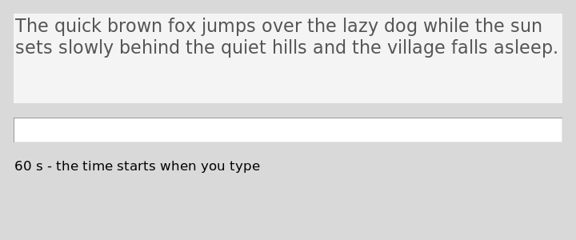
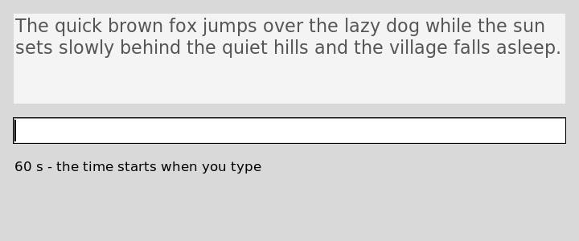
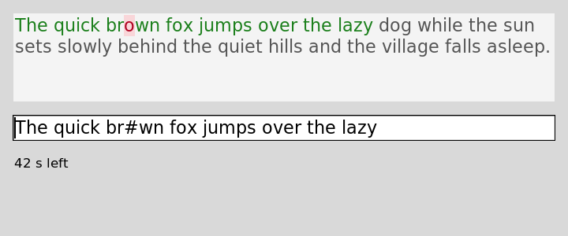
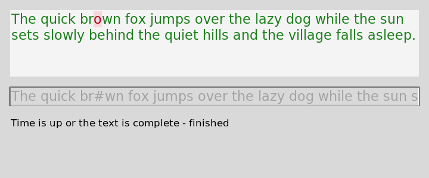

# 🚀 Typing Speed Test

A desktop application that tests how fast you type: it shows a sample text, times you while you type it and reports your words per minute and accuracy. It is the Day 86 assignment of the Udemy course "100 Days of Code: The Complete Python Pro Bootcamp", written for course participants and for visitors who want a readable, runnable example.

## 📚 Table of Contents

- [Overview](#-overview)
- [Requirements](#-requirements)
- [Setup](#-setup)
- [Run](#-run)
- [Tests](#-tests)
- [Steps](#-steps)
- [License](#-license)
- [Links](#-links)
- [Appendix: Project documents](#-appendix-project-documents)

## 🧭 Overview

The program is built in four steps, and each step has a screenshot here and a wiki page (English, Danish and Bahasa Malaysia) that explains what the step taught:

1. Step 1: a window that shows a sample text (`start_test`).
2. Step 2: a timer that starts with the first key and live feedback on right and wrong characters.
3. Step 3: the result in words per minute and accuracy (`calculate_wpm`, `calculate_accuracy`), and a restart.
4. Step 4: a trainer with more sample texts and a high score list (`save_high_score`).

The repository is laid out as follows:

| Folder or file | Holds |
| --- | --- |
| `src/typing_speed_test/` | The application, in layers: `domain`, `application`, `infrastructure` and `presentation` |
| `src/typing_speed_test/constants.py` | Every constant of the application |
| `tests/` | The pytest tests: `unit`, `integration` and `gui` |
| `docs/` | Project documents, the wiki sources (`docs/wiki/`) and the screenshots (`docs/screenshots/`) |
| `docker/gui/` | The Linux container in which graphical tests and screenshots run |
| `scripts/` | `check.sh`, the quality gate, and `run-gui-tests.sh`, the container runner |
| `pyproject.toml` | The single configuration file of the project and its tools |
| `Doxyfile` | The Doxygen configuration for the source comments |

## 📋 Requirements

- Python 3.13 or newer, with Tkinter (included in the standard installers of Python).
- No runtime dependency: the program uses the standard library only.
- For development only: pytest, pytest-cov, ruff, mypy and import-linter (installed with the `dev` group), Doxygen for the source manual, Docker for graphical tests and screenshots, and opengrep for the security scan.

## 🛠️ Setup

Create a local virtual environment named `.venv`, activate it, upgrade pip and install the project.

On Windows (PowerShell):

```powershell
python -m venv .venv
.venv\Scripts\Activate.ps1
python -m pip install --upgrade pip
python -m pip install -e ".[dev]"
```

On Linux and macOS:

```bash
python3 -m venv .venv
source .venv/bin/activate
python -m pip install --upgrade pip
python -m pip install -e ".[dev]"
```

Leave the environment with `deactivate`. Install without the development tools with `python -m pip install -e .`.

## ▶️ Run

With the environment active:

```bash
python -m typing_speed_test
```

The program is available from step 1 on. The controls of each step are described in the wiki.

## 🧪 Tests

With the environment active:

```bash
python -m pytest
```

Before a push, run the whole quality gate (tests with coverage, ruff, mypy, import-linter and the opengrep scan):

```bash
bash scripts/check.sh
```

Graphical tests and screenshots never run on your desktop. They run in a Linux container with a virtual display:

```bash
bash scripts/run-gui-tests.sh python -m pytest -m gui
```

Build the source manual with `doxygen Doxyfile`; it is written to `build/doxygen/index.html`.

## 🪟 Steps

Each step has screenshots made in a Linux container and a wiki page that explains what it taught.

### 🪟 Step 1: window and sample text

`start_test` chooses a sample text and the window shows it with an empty input field. The time does not run until you type.





Wiki: [Step 1][step-1].

### 🪟 Step 2: timer and typing

The time starts with the first character. Right characters turn green, wrong ones red, and the status line counts down from 60 seconds. When the text is complete or the time is over, the input is locked.





Wiki: [Step 2][step-2].

## 📄 License

GNU Affero General Public License, version 3. See the [LICENSE][license] file.

## 🔗 Links

- [Repository][repository]
- [Documentation][documentation]
- [Issue tracker][issues]
- [Tkinter documentation][tkinter], the reference of the assignment
- [Typing speed test (web version)][web-version], the example named in the assignment

## 📎 Appendix: Project documents

The documents a newcomer needs, in reading order.

| Document | What it tells you |
| --- | --- |
| [Business Case][BC-001] | Why the project exists, its scope and success criteria |
| [Stakeholder Analysis][SA-001] | Who is involved; the stakeholder IDs used for owners and reviewers |
| [Project Plan][PP-001] | The gateways and their schedule |
| [Milestones][milestones] | One document per gateway: Go/No-Go criteria and tasks |
| [Artifact registry][registry] | Where each artifact type lives, the next version, the PO language and domain |
| [Framework README][framework-readme] | The framework this project uses |
| [Framework changelog][framework-changelog] | What changed in each framework release |

---

[repository]: https://git.tirsystem.com/Tirsvad-Udemy-100-days-of-code/086-assignment-typing-speed-test
[documentation]: https://git.tirsystem.com/Tirsvad-Udemy-100-days-of-code/086-assignment-typing-speed-test/wiki
[issues]: https://git.tirsystem.com/Tirsvad-Udemy-100-days-of-code/086-assignment-typing-speed-test/issues
[tkinter]: https://docs.python.org/3/library/tkinter.html
[web-version]: https://typing-speed-test.aoeu.eu/
[license]: ./LICENSE
[step-2]: https://git.tirsystem.com/Tirsvad-Udemy-100-days-of-code/086-assignment-typing-speed-test/wiki/Step-2-Timer-And-Typing
[step-1]: https://git.tirsystem.com/Tirsvad-Udemy-100-days-of-code/086-assignment-typing-speed-test/wiki/Step-1-Window-And-Text
[BC-001]: ./docs/business-case.md
[SA-001]: ./docs/stakeholder-analysis.md
[PP-001]: ./docs/project-plan.md
[milestones]: ./docs/milestones/
[registry]: ./docs/artifact-registry.md
[framework-readme]: ./framework/README.md
[framework-changelog]: ./framework/CHANGELOG.md
