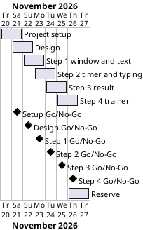

# Project Plan: Typing Speed Test Desktop App

## Metadata
| Key | Value |
| --- | --- |
| ID | PP-001 |
| CrossReference | [BC-001], [SA-001], [MIL-001], [MIL-002], [MIL-003], [MIL-004], [MIL-005], [MIL-006], [US-001] |
| Language | en |
| Domain | it |

## Version History
| Date | Status | Author | Reviewer | Change | Commit |
| --- | --- | --- | --- | --- | --- |
| 2026-11-20 | Accepted | Jens Tirsvad Nielsen | Stand-in for S01 | Initial version<br>Accepted on Go in RC-004 | pending |

---

## Purpose

This plan schedules the six gateways of the Typing Speed Test Desktop App inside the one-week window of [BC-001], from 2026-11-20 to 2026-11-27. Each gateway is one milestone document, one branch and one pull request, so the build steps stay traceable.

## Planning Assumptions

- Week 1 starts 2026-11-20; the plan ends by 2026-11-27. No deadline was given, so the window is the author's proposal for S01 to confirm (source: [BC-001] Constraints).
- Phase length: one day per gateway, with one day of reserve before the end date. S01 is the only person who works on the project (source: [SA-001]).
- Each gateway has its own branch (`mil-NNN-<slug>`) and pull request; a reviewer merges. In autonomous mode the pull request is merged after its checks are green, as `AGENTS.md` sets out.
- The local quality gate, including the opengrep scan, runs before every push (source: [BC-001] Constraints).
- The plan-first gate holds: no file under `src/` or `tests/` is written before the gateway's milestone is `Accepted` with a Go review.
- The repository name follows the existing `origin` remote and not the underscore spelling in the first prompt.
- The build steps are the author's reading of the assignment, which names none: (1) window and sample text, (2) timer and live typing feedback, (3) result and restart, (4) trainer with more texts and high scores.
- The function names `start_test`, `calculate_wpm`, `calculate_accuracy` and `save_high_score` are the author's proposal; the assignment names none.
- Open for S01 to confirm when accepting the plan: the one-week window, the reading of "greater than 3.13" as 3.13 or newer, the standard library as the only runtime dependency, the four steps, the function names, the repository name, and a local PlantUML server at `http://localhost:8080` (a container).

## Gateway Schedule

| Gateway | Document | Window | Decision date | Owner | Stories | Main deliverable | Milestone |
| --- | --- | --- | --- | --- | --- | --- | --- |
| Project setup | [MIL-001] | 2026-11-20 to 2026-11-21 | 2026-11-21 | S01 | US-001.07, US-001.08 | Accepted baseline, repository tooling, README, wiki skeleton, Docker harness, ADRs | not yet synced |
| Design | [MIL-002] | 2026-11-21 to 2026-11-22 | 2026-11-22 | S01 | US-001.01 to US-001.06 | Accepted design artifacts of UC-001 | not yet synced |
| Step 1, window and sample text | [MIL-003] | 2026-11-22 to 2026-11-23 | 2026-11-23 | S01 | US-001.01 | Window and `start_test`, step 1 documentation | not yet synced |
| Step 2, timer and typing | [MIL-004] | 2026-11-23 to 2026-11-24 | 2026-11-24 | S01 | US-001.02 | Timer and live feedback, step 2 documentation | not yet synced |
| Step 3, result and restart | [MIL-005] | 2026-11-24 to 2026-11-25 | 2026-11-25 | S01 | US-001.03, US-001.04 | `calculate_wpm`, `calculate_accuracy`, restart, step 3 documentation | not yet synced |
| Step 4, trainer | [MIL-006] | 2026-11-25 to 2026-11-26 | 2026-11-26 | S01 | US-001.05, US-001.06 | Text chooser, `save_high_score`, completed documentation, verified success criteria | not yet synced |



## Scope Coverage

| Business Case scope item | Gateway |
| --- | --- |
| Window and sample text (step 1) | [MIL-003] |
| Timer and live typing feedback (step 2) | [MIL-004] |
| Result with words per minute and accuracy, restart (step 3) | [MIL-005] |
| More text samples and high scores (step 4) | [MIL-006] |
| `pyproject.toml`, `.gitignore`, `.editorconfig`, `Doxyfile`, `constants.py`, `tests/` | [MIL-001] |
| README with `.venv` and pip instructions, run and test instructions | [MIL-001], completed in [MIL-006] |
| README screenshots and wiki pages per step in three languages | [MIL-003] to [MIL-006]; skeleton in [MIL-001] |
| Reflection wiki page in three languages | [MIL-006] |
| Screenshots produced in a Docker container | [MIL-001] harness, [MIL-003] to [MIL-006] captures |
| Repository description and topics | [MIL-001] |
| Framework project documents (use case and design, dictionary, traceability, reviews, decisions) | [MIL-001] decisions, [MIL-002] design |

## Dependencies

```
MIL-001 → MIL-002 → MIL-003 → MIL-004 → MIL-005 → MIL-006
```

A No-Go at a gateway stops the later gateways. The gateway is reworked and decided again; the end date 2026-11-27 moves only if the reserve day is used up, and only S01 decides to move it, recording the new date in a new Version History row of this plan and of [BC-001].

## Plan Risks

| Risk | Impact | Mitigation |
| --- | --- | --- |
| The Docker harness takes longer than a day to work (virtual display, fonts, screenshot tool) | Gateway 1 and every screenshot task slip | Build the harness first in gateway 1; if it fails, stop and report instead of using the host desktop; the reserve day absorbs one slip |
| Reviews of the many design artifacts take longer than planned | Gateway 2 slips | One use case only; design artifacts that nothing needs are skipped with a recorded reason |
| Danish and Bahasa Malaysia pages need a native-reader check | Wiki reviews stay conditional | Keep the sentences short and the terms fixed; the language criteria stay pending until S01 confirms (Business Case risk on wiki quality) |
| The git host token lacks a scope (issues, repository, wiki) | Sync, push or wiki publication fails | Check each scope in gateway 1 and stop if one is missing; no workaround |
| Two pull requests need the same file (README, wiki sidebar) | Merge conflicts | One pull request at a time, in gateway order |
| Timing tests are slow or flaky | Unreliable gates | The clock is a port; tests use a fake clock and never sleep |

## Open Issues

- Wiki publication needs the wiki enabled for the repository and the publish workflow of the git host; both are checked in gateway 1.
- The language criteria of the Danish and Bahasa Malaysia wiki pages need a person who reads those languages; the stand-in reviews leave them pending until S01 has checked them.
- Publication of the milestones and issues on the git host follows the framework: by the publish workflow after merge when it is installed, otherwise by `sync-project.sh --apply` once the plan is accepted.

---

[BC-001]: ./business-case.md
[SA-001]: ./stakeholder-analysis.md
[US-001]: ./user-stories.md
[MIL-001]: ./milestones/mil-001-project-setup.md
[MIL-002]: ./milestones/mil-002-design.md
[MIL-003]: ./milestones/mil-003-step-1-window-and-text.md
[MIL-004]: ./milestones/mil-004-step-2-timer-and-typing.md
[MIL-005]: ./milestones/mil-005-step-3-result.md
[MIL-006]: ./milestones/mil-006-step-4-trainer.md
