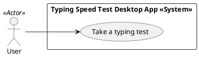

# Use Case Diagram: Typing Speed Test Desktop App

## Metadata
| Key | Value |
| --- | --- |
| ID | UCD-001 |
| CrossReference | [SA-001], [BC-001], [US-001], [UC-001] |
| Language | en |
| Domain | it |

## Version History
| Date | Status | Author | Reviewer | Change | Commit |
| --- | --- | --- | --- | --- | --- |
| 2026-11-20 | Accepted | Jens Tirsvad Nielsen | Stand-in for S01 | Initial version Accepted on Go in RC-018 | pending |

---

## Purpose and Scope

The diagram shows the boundary of the Typing Speed Test Desktop App: one actor, the User, and the one goal the system serves, "Take a typing test". It serves the stories US-001.01 to US-001.06 of [US-001]. The stories US-001.07 and US-001.08 are not goals of an actor of the system and are not shown.

## Diagram

Crossings of the chosen layout: 0 (one actor, one use case, one association).

## Actor Table

| Actor | Stereotype | Stakeholder ID (SA) | Goals (use cases) |
| --- | --- | --- | --- |
| User | `<<Actor>>` | S01, S02 | Take a typing test |

## Use Case Table

| Use Case | Actor(s) | Goal | Source story | Priority (MoSCoW) | Reason |
| --- | --- | --- | --- | --- | --- |
| Take a typing test | User | Find out how fast and how correctly I type, try again, and see my best results | US-001.01 to US-001.06 | Must | The core goal of the assignment (objectives O1 and O2 of [BC-001]) |

## Role Matrix

Not applicable: there is one primary actor, so there is no role to separate and no matrix to approve.

## Relationships

| From | Relationship (`<<include>>` / `<<extend>>`) | To | Justification |
| --- | --- | --- | --- |
| - | - | - | There is one use case, so no `<<include>>` or `<<extend>>` exists |

---

[SA-001]: ./stakeholder-analysis.md
[BC-001]: ./business-case.md
[US-001]: ./user-stories.md
[UC-001]: use-cases/uc-001/uc.md
