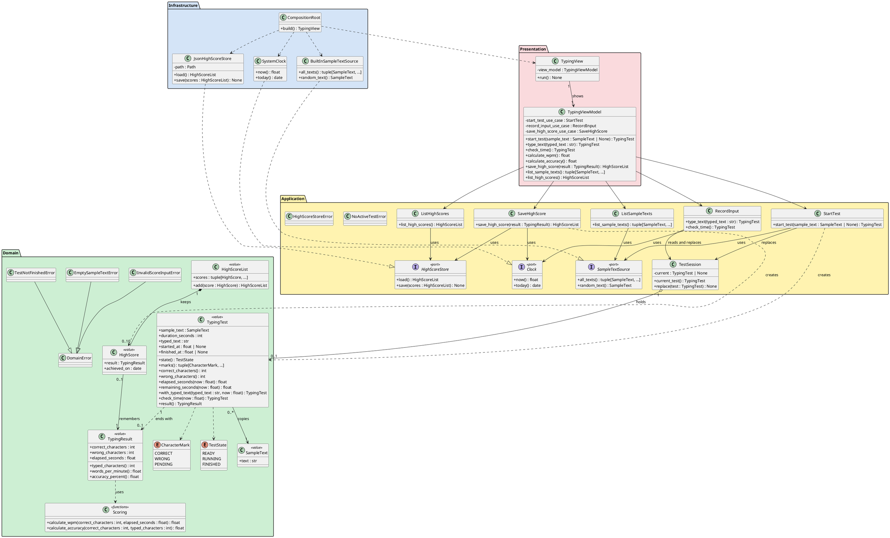

# Design Class Diagram: UC-001 Take a typing test

## Metadata
| Key | Value |
| --- | --- |
| ID | DCD-001 |
| CrossReference | [DM-001], [SD-001], [OC-001], [DICT-001] |

## Version History
| Date | Status | Author | Reviewer | Change | Commit |
| --- | --- | --- | --- | --- | --- |
| 2026-11-20 | Accepted | Jens Tirsvad Nielsen | Stand-in for S01 | Initial version Accepted on Go in RC-024 | [a388508] |

---

## Purpose and Scope

This diagram fixes the classes that carry out use case [UC-001], "Take a typing test". It refines the concepts of the Domain Model [DM-001] with the design decisions of the Sequence Diagrams [SD-001] and the Operation Contracts [OC-001]. It answers the concerns CN-001 (the speed and accuracy are measured correctly), CN-004 (the code uses clear function names), CN-008 (no runtime dependency) and CN-009 (the time is accurate and the window stays responsive) of [SA-001], and serves the developer S01 and the readers S02. The layers follow ADR-0002; the names are the IT terms of [DICT-001]. No project-level Design Class Diagram exists yet; this one becomes its first content.

## Diagram

The four packages are the four layers, in their fixed colours: Presentation (Delivery) `#FADADD`, Application `#FFF3B0`, Domain `#CDEFD3` and Infrastructure `#D4E4F7`. Every class sits in one package. The package dependencies point inward: Presentation depends on Application and Domain, Application depends on Domain, Infrastructure depends on Application and Domain, and Domain depends on nothing. The three ports `Clock`, `SampleTextSource` and `HighScoreStore` are owned by the Application layer and implemented by the Infrastructure layer.

## Class Table

| Class | Refines (Domain Model concept) | Responsibility | Attributes | Operations |
| --- | --- | --- | --- | --- |
| `SampleText` | Sample text | Holds one passage and refuses an empty one | `+text : str` | none |
| `TypingTest` | Typing test | Holds the sample text, the time allowed and the typed text, and marks the characters | `+sample_text`, `+duration_seconds`, `+typed_text`, `+started_at`, `+finished_at` | `state`, `marks`, `correct_characters`, `wrong_characters`, `elapsed_seconds`, `remaining_seconds`, `with_typed_text`, `check_time`, `result` |
| `TypingResult` | Result | Holds the counts and works out words per minute and accuracy | `+correct_characters`, `+wrong_characters`, `+elapsed_seconds` | `typed_characters`, `words_per_minute`, `accuracy_percent` |
| `Scoring` | Result (the rules) | Holds the two formulas as pure functions | none | `calculate_wpm`, `calculate_accuracy` |
| `HighScore` | High score | Pairs a result with the day it was reached | `+result`, `+achieved_on` | none |
| `HighScoreList` | High score (the ten best) | Keeps the ten best, best first | `+scores` | `add` |
| `CharacterMark`, `TestState` | none (design enumerations for right, wrong, waiting and ready, running, finished) | Name the states the sequence diagrams use | none | none |
| `DomainError`, `EmptySampleTextError`, `TestNotFinishedError`, `InvalidScoreInputError` | none (design exceptions) | Name the refusals of the domain | none | none |
| `Clock`, `SampleTextSource`, `HighScoreStore` | none (ports) | The interfaces the Application layer owns | none | `now`, `today`; `all_texts`, `random_text`; `load`, `save` |
| `TestSession` | Typing test (the current one) | Holds the current typing test | `-current` | `current_test`, `replace` |
| `ListSampleTexts`, `StartTest`, `RecordInput`, `SaveHighScore`, `ListHighScores` | none (use case classes) | One operation family each | none | the operations of [OC-001] |
| `NoActiveTestError`, `HighScoreStoreError` | none (design exceptions) | Name the refusals of the Application layer | none | none |
| `SystemClock`, `BuiltInSampleTextSource`, `JsonHighScoreStore` | none (adapters) | Implement the ports with the system clock, the built-in texts and a file | `-path` | the port operations |
| `CompositionRoot` | none | Builds the objects and joins them | none | `build` |
| `TypingViewModel`, `TypingView` | none (presentation) | Hold what the window shows, and draw it | `-view_model`, the use case references | the operations of [OC-001] |

## Method Traceability

| Method signature | Operation Contract / SD message |
| --- | --- |
| `ListSampleTexts.list_sample_texts() : tuple[SampleText, ...]` | `list_sample_texts` of [OC-001]; SD `list_sample_texts` |
| `StartTest.start_test(sample_text) : TypingTest` | `start_test` of [OC-001]; SD `start_test` |
| `RecordInput.type_text(typed_text) : TypingTest` | `type_text` of [OC-001]; SD `type_text` |
| `RecordInput.check_time() : TypingTest` | `check_time` of [OC-001]; SD `check_time` |
| `TypingTest.with_typed_text(typed_text, now)` | SD `type_text`, message `with_typed_text` |
| `TypingTest.check_time(now)` | SD `check_time`, message `check_time` |
| `TypingResult.words_per_minute()`, `Scoring.calculate_wpm(...)` | `calculate_wpm` of [OC-001]; SD `calculate_wpm` |
| `TypingResult.accuracy_percent()`, `Scoring.calculate_accuracy(...)` | `calculate_accuracy` of [OC-001]; SD `calculate_accuracy` |
| `SaveHighScore.save_high_score(result) : HighScoreList` | `save_high_score` of [OC-001]; SD `save_high_score` |
| `HighScoreList.add(score)` | SD `save_high_score`, message `add` |
| `ListHighScores.list_high_scores() : HighScoreList` | `list_high_scores` of [OC-001]; SD `list_high_scores` |
| `Clock.now()`, `Clock.today()` | SD `type_text`, `check_time`, `save_high_score` |
| `SampleTextSource.all_texts()`, `random_text()` | SD `list_sample_texts`, `start_test` |
| `HighScoreStore.load()`, `save(scores)` | SD `save_high_score`, `list_high_scores` |
| `TestSession.current_test()`, `replace(test)` | SD `start_test`, `type_text`, `check_time` |

## Pattern Annotations

| Pattern | Classes | Rationale |
| --- | --- | --- |
| Model-View-ViewModel | `TypingView`, `TypingViewModel` | The view draws; the view model holds the state; neither holds a rule |
| Port and adapter | `Clock`, `SampleTextSource`, `HighScoreStore` and the three adapters | The inner layers own the interface, so tests use fakes and the standard library stays at the edge |
| Value object | `SampleText`, `TypingTest`, `TypingResult`, `HighScore`, `HighScoreList` | Immutable data; a change returns a new instance |
| Information Expert | `TypingTest`, `HighScoreList`, `Scoring` | The object with the data does the work |
| Facade (controller) | `TypingViewModel` | One entry point for the view over five use case classes |
| Composition root | `CompositionRoot` | The only place that names the concrete adapters |

## Dependency Check

- Domain imports nothing from the other layers; `Scoring` and the value objects use only the standard library.
- Application imports Domain only; the three ports are its own interfaces, so no concrete adapter is named there.
- Infrastructure imports Application and Domain, and implements the ports; `CompositionRoot` is the one class that names the adapters.
- Presentation imports Application and Domain; it never names an adapter.
- No cycle exists between packages. The same contracts are checked by import-linter in `pyproject.toml`.
- `TypingViewModel` has five collaborators and each use case class has one operation family, so no class is a god class.

---

[SD-001]: ./sd.md
[DICT-001]: ../../dictionary.md
[UC-001]: ./uc.md
[DM-001]: ./dm.md
[OC-001]: ./oc.md
[SA-001]: ../../stakeholder-analysis.md
[a388508]: https://git.tirsystem.com/Tirsvad-Udemy-100-days-of-code/086-assignment-typing-speed-test/commit/a388508748c9a53f3406d8634714e2d0caba7220
