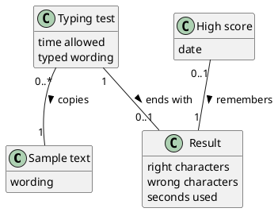

# Domain Model: UC-001 Take a typing test

## Metadata
| Key | Value |
| --- | --- |
| ID | DM-001 |
| CrossReference | [UC-001], [UCD-001], [SA-001] |
| Language | en |
| Domain | it |

## Version History
| Date | Status | Author | Reviewer | Change | Commit |
| --- | --- | --- | --- | --- | --- |
| 2026-11-20 | Accepted | Jens Tirsvad Nielsen | Stand-in for S01 | Initial version Accepted on Go in RC-020 | pending |

---

## Purpose and Scope

This model covers use case [UC-001], "Take a typing test", in the Product Owner's words. It answers the concerns CN-001 (the speed and accuracy are measured correctly) and CN-009 (the time is accurate) of [SA-001] and serves S01 and S02. The words per minute and the accuracy are not attributes: they are worked out from the right characters, the wrong characters and the seconds used. No project-level Domain Model exists yet; this model becomes its first content.

## Diagram

## Concept Table

| Concept | Definition | Attributes | Source (use case noun phrase / glossary) |
| --- | --- | --- | --- |
| Sample text | A passage of ordinary writing that a person copies when practising typing. | wording | "sample text" in UC-001 steps 2 and 3 |
| Typing test | A timed attempt to copy a sample text as fast and as correctly as you can. | time allowed, typed wording | "typing test" in steps 1 and 5 |
| Result | How well someone did in one typing test, counted in right and wrong characters and the seconds used. | right characters, wrong characters, seconds used | "result" in steps 6 and 7 |
| High score | A result that is good enough to be kept among the ten best. | date | "ten best results" in step 7 |

## Association Table

| From | Association name (with reading direction) | To | Multiplicity (both ends) |
| --- | --- | --- | --- |
| Typing test | copies | Sample text | 0..* to 1 |
| Typing test | ends with | Result | 1 to 0..1 |
| High score | remembers | Result | 0..1 to 1 |

## Generalizations

None: no concept is a kind of another concept.

---

[UC-001]: ./uc.md
[UCD-001]: ../../use-case-diagram.md
[SA-001]: ../../stakeholder-analysis.md
