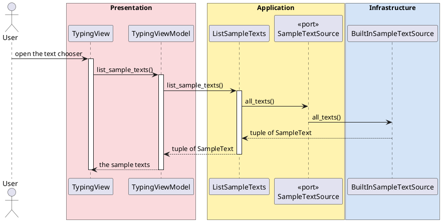
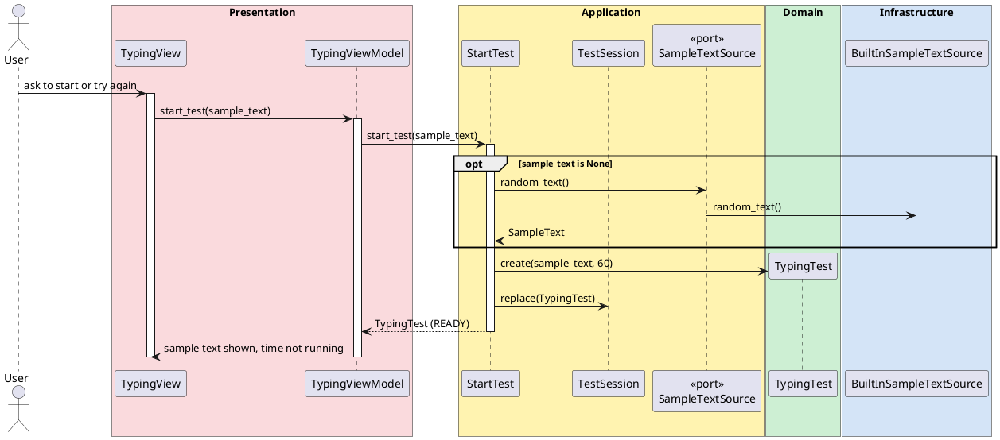
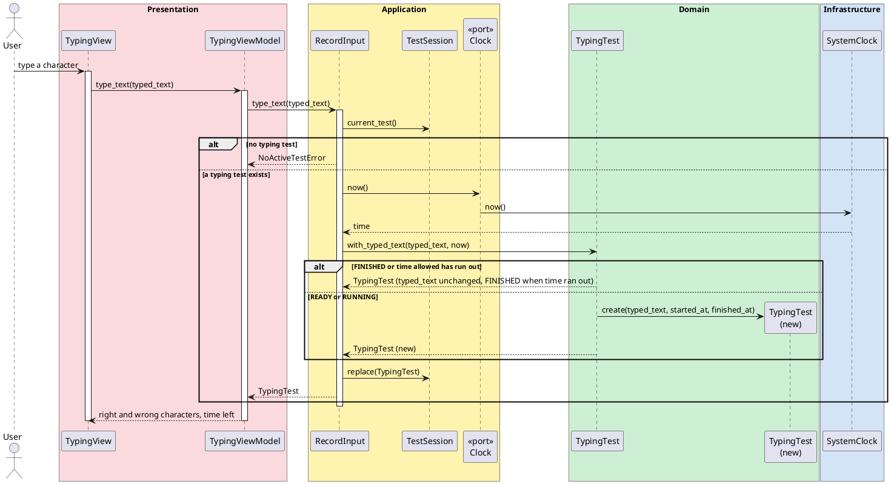
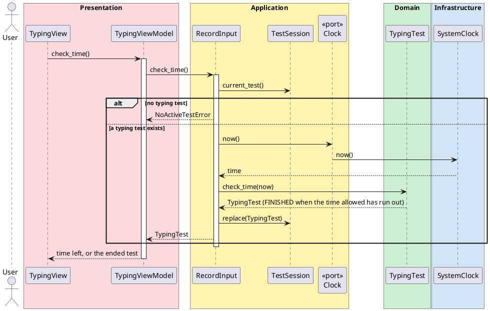
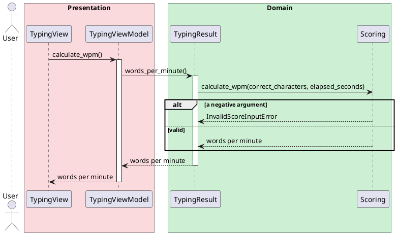
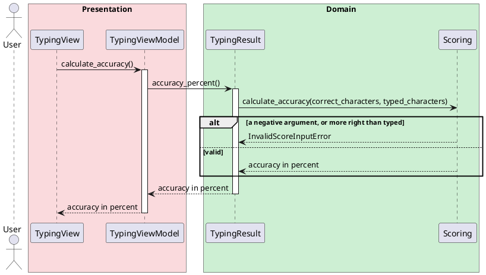
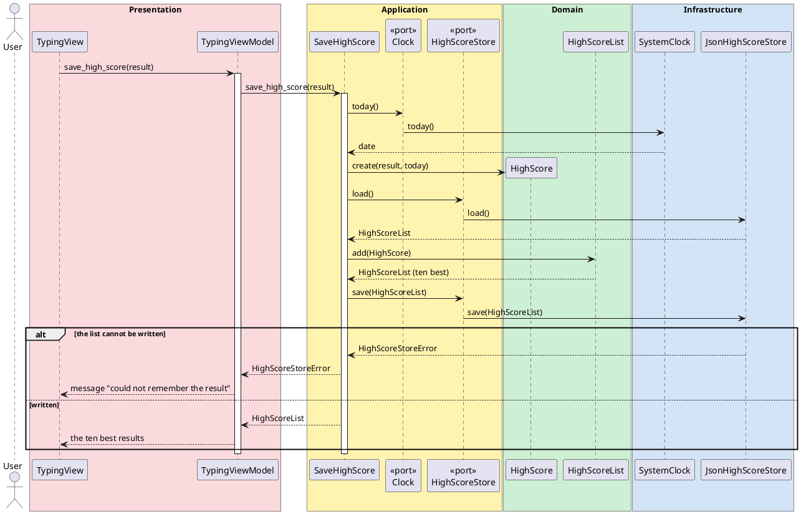
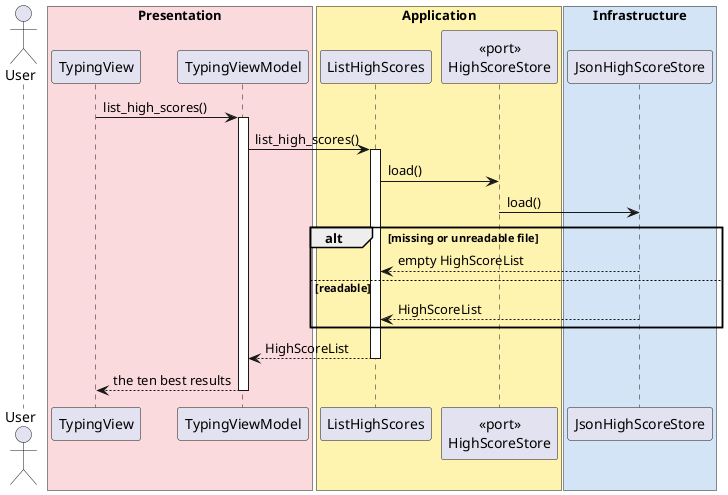

# Sequence Diagrams: UC-001 Take a typing test

## Metadata
| Key | Value |
| --- | --- |
| ID | SD-001 |
| CrossReference | [OC-001], [DICT-001] |

## Version History
| Date | Status | Author | Reviewer | Change | Commit |
| --- | --- | --- | --- | --- | --- |
| 2026-11-20 | Accepted | Jens Tirsvad Nielsen | Stand-in for S01 | Initial version Accepted on Go in RC-023 | [a388508] |

---

## Purpose

These diagrams show how the objects of [UC-001] carry out the eight contracts of [OC-001]. They answer the concerns CN-001 (the speed and accuracy are measured correctly), CN-004 (the code uses clear function names) and CN-009 (the time is accurate and the window stays responsive) of [SA-001], and serve the developer S01 and the readers S02. The layers follow ADR-0002: Presentation (Delivery), Application, Domain and Infrastructure. Every call into the Infrastructure layer goes through a port that the Application layer owns; the Infrastructure objects implement the ports. Terms are the IT terms of [DICT-001]. Time is read only through the `Clock` port, so tests can replace it.

## Realizes: list_sample_texts

The contract is `list_sample_texts` of [OC-001].

## Realizes: start_test

The contract is `start_test` of [OC-001].

An empty sample text cannot reach this operation: `SampleText` refuses to be created with an empty text (`EmptySampleTextError`), so the exception of the contract is raised where the text is created and the earlier typing test stays in `TestSession`.

## Realizes: type_text

The contract is `type_text` of [OC-001].

## Realizes: check_time

The contract is `check_time` of [OC-001].

## Realizes: calculate_wpm

The contract is `calculate_wpm` of [OC-001].

## Realizes: calculate_accuracy

The contract is `calculate_accuracy` of [OC-001].

## Realizes: save_high_score

The contract is `save_high_score` of [OC-001].

## Realizes: list_high_scores

The contract is `list_high_scores` of [OC-001].

## Pattern Annotations

| Pattern (GRASP/GoF) | Applied to | Rationale |
| --- | --- | --- |
| Controller (GRASP) | `TypingViewModel` | It is the one object the view talks to; it only forwards to the use cases and the domain |
| Model-View-ViewModel | `TypingView`, `TypingViewModel` | The view draws; the view model holds the state the view shows; neither holds a rule |
| Port and adapter (hexagonal) | `Clock`, `SampleTextSource`, `HighScoreStore` and their implementations | The inner layers own the interface; the outer layer implements it, so tests use fakes |
| Value object | `SampleText`, `TypingTest`, `TypingResult`, `HighScore`, `HighScoreList` | Immutable data with its rules; every change returns a new instance |
| Information Expert (GRASP) | `TypingTest`, `HighScoreList`, `Scoring` | The object that has the data does the work: marks, ending and ranking |
| Pure Fabrication (GRASP) | `TestSession`, the use case classes | They hold the current test and order the steps; they are not concepts of the domain |

## Postcondition Coverage

| Postcondition | Satisfied by message |
| --- | --- |
| `list_sample_texts`: the sample texts are returned, none modified | `all_texts()` through `SampleTextSource` |
| `start_test`: a typing test is created with a sample text, 60 seconds, empty input, READY; earlier test dropped | `create(sample_text, 60)` and `replace(TypingTest)` |
| `type_text`: typed_text modified, start time set on the first character, FINISHED at the end of the text or of the time, unchanged when finished | `with_typed_text(typed_text, now)` and `replace(TypingTest)` |
| `check_time`: FINISHED when the time allowed has run out | `check_time(now)` and `replace(TypingTest)` |
| `calculate_wpm`: the number of words per minute, 0 for 0 seconds | `calculate_wpm(correct_characters, elapsed_seconds)` |
| `calculate_accuracy`: the percentage of right characters, 0 for nothing typed | `calculate_accuracy(correct_characters, typed_characters)` |
| `save_high_score`: a HighScore created for today, the ten best kept and stored | `create(result, today)`, `add(HighScore)`, `save(HighScoreList)` |
| `list_high_scores`: the stored list, or an empty list | `load()` through `HighScoreStore` |

## Responsibility Check

No object receives all messages. The view model forwards to six use case objects; each use case object has one operation family and talks to at most one port beside the session; the rules for marking, ending, counting and ranking live in the domain value objects; the clock, the texts and the file are behind ports.

---

[OC-001]: ./oc.md
[DICT-001]: ../../dictionary.md
[UC-001]: ./uc.md
[SA-001]: ../../stakeholder-analysis.md
[a388508]: https://git.tirsystem.com/Tirsvad-Udemy-100-days-of-code/086-assignment-typing-speed-test/commit/a388508748c9a53f3406d8634714e2d0caba7220
