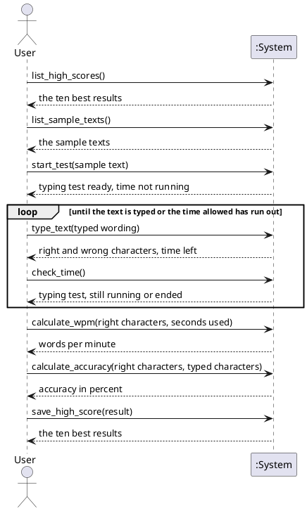
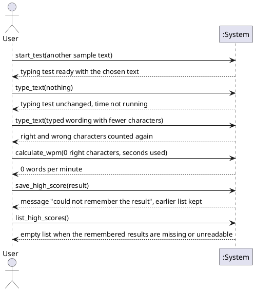

# System Sequence Diagram: UC-001 Take a typing test

## Metadata
| Key | Value |
| --- | --- |
| ID | SSD-001 |
| CrossReference | [UC-001], [DM-001] |
| Language | en |
| Domain | it |

## Version History
| Date | Status | Author | Reviewer | Change | Commit |
| --- | --- | --- | --- | --- | --- |
| 2026-11-20 | Accepted | Jens Tirsvad Nielsen | Stand-in for S01 | Initial version Accepted on Go in RC-021 | pending |

---

## Source Use Case

[UC-001], "Take a typing test": the main success scenario. The extensions are depicted in the second diagram. The concepts are those of [DM-001].

## Diagram

Alternative flows, in one diagram:

## System Operations Table

| Step | Message (verb phrase) | Parameters | Return | Use case step |
| --- | --- | --- | --- | --- |
| 1 | list_high_scores | none | the ten best results, or an empty list | 2, 7a |
| 2 | list_sample_texts | none | the sample texts | 2a |
| 3 | start_test | sample text (optional) | the typing test, ready, time not running | 1, 2, 2a |
| 4 | type_text | typed wording | right and wrong characters, time left, or the ended typing test | 3, 3a, 3b, 4, 5 |
| 5 | check_time | none | the typing test, still running or ended | 4, 5 |
| 6 | calculate_wpm | right characters, seconds used | words per minute | 6, 6a |
| 7 | calculate_accuracy | right characters, typed characters | accuracy in percent | 6, 6a |
| 8 | save_high_score | result | the ten best results, or the message of extension 7b | 7, 7b, 8 |

The message names are the function names of the assignment and of the design; they become the Operation Contract names. `check_time` stands for the passing of time: the time left runs down without a key press, so the system is asked about it regularly while the test runs.

## Lifecycle Notes

The system exists for as long as the program runs; one typing test is worked on at a time. A new `start_test` drops the earlier typing test. Asking to try again repeats the scenario from step 1 of the use case.

---

[UC-001]: ./uc.md
[DM-001]: ./dm.md
